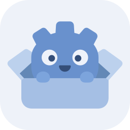

<div align="center">



# GodotTool

**在 Android 上，找回你的 Godot 项目。**

从 APK、PCK 或资源 ZIP 中提取资源、恢复脚本，整理为可浏览的项目文件。

<p>
  
  
  
  
  
</p>

<p>
  <a href="https://github.com/tingdong105/GodotTool/releases">📦 下载版本</a>
  &nbsp; · &nbsp;
  <a href="#-功能亮点">✨ 功能亮点</a>
  &nbsp; · &nbsp;
  <a href="#-快速上手">🚀 快速上手</a>
  &nbsp; · &nbsp;
  <a href="https://github.com/tingdong105/GodotTool/issues">💬 问题反馈</a>
</p>

</div>

---

## 关于项目

**GodotTool** 是一款使用 Kotlin 与 Jetpack Compose 开发的 Android 端 Godot 项目恢复工具，以 **GDRE Tools** 为解析与恢复核心，搭配 **miuix** 界面。

选择文件、确定恢复范围、查看处理结果——从导入到导出，都可以在手机上完成。适合项目备份找回、资源检查与脚本阅读。

## ✨ 功能亮点

| | 功能 | 说明 |
| :---: | :--- | :--- |
| 📦 | 多种格式导入 | 支持 APK、PCK 和 Godot 资源 ZIP，可同时选择 APK 分包。 |
| 🧩 | 工程恢复 | 恢复项目脚本、场景、资源配置、素材、插件与项目入口配置，按原有路径整理结果。 |
| 🎯 | 按需选择 | 提供「完整工程」「仅项目脚本」和自定义范围，可选保留原始副本。 |
| 🔍 | 文件浏览与预览 | 内置文件浏览器，支持文本、图片和二进制十六进制预览。 |
| ⏳ | 任务进度与记录 | 查看处理阶段、进度和日志，支持取消任务、回看历史结果与恢复报告。 |
| 💾 | 自动 ZIP 导出 | 结果保存至共享存储，按日期与次数命名，避免覆盖历史结果。 |
| 🌗 | 明暗主题 | 支持跟随系统、浅色和深色模式。 |
| 🔧 | NodeMotion 适配 | 自动识别已适配的 NM sparsepck v4 资源结构，分析密钥材料并校验解密结果。 |

## 🚀 快速上手

设备需运行 **Android 9.0（API 28）及以上**，并支持 **arm64-v8a**。

1. 在 [Releases](https://github.com/tingdong105/GodotTool/releases) 查看已发布版本，或按下方说明自行构建 APK。
2. 打开应用，点击「选择文件」，按提示授予存储访问权限。
3. 选择 APK、PCK 或 Godot 资源 ZIP；分包项目可同时选择相关 APK。
4. 选择恢复范围，按需开启「保留原始副本」，开始恢复。
5. 完成后查看项目文件与恢复报告，或到共享存储的 `GodotTool/` 目录获取 ZIP。

### 选择适合的恢复范围

| 恢复方式 | 适用场景 |
| :--- | :--- |
| **完整工程** | 希望尽可能恢复项目文件，后续在 Godot 编辑器中检查和修复。 |
| **仅项目脚本** | 只需要阅读项目脚本，不导出插件、场景、素材和项目配置。 |
| **自定义** | 自行选择脚本、场景与资源配置、素材与数据、插件或项目入口配置。 |

### 结果保存在哪里？

结果自动保存为共享存储中的 **`GodotTool/yyMMdd_次数.zip`**，例如 `GodotTool/261124_1.zip`。同一天的后续任务会递增编号。

归档中的 `project/` 保存整理后的项目，`reports/` 保存报告；开启「保留原始副本」时，还会包含 `raw/`。归档也可能包含任务结果与诊断日志，方便排查未完成的恢复。

## 📋 兼容性说明

- **输入内容**：APK 或 ZIP 中需要包含可识别的 Godot 项目资源。
- **恢复效果**：取决于 Godot 版本、导出方式及资源是否完整；完整工程模式表示恢复范围，恢复后的项目可能仍需手动修复。
- **脚本恢复**：使用内置 GDRE Tools 核心提供的反编译能力，具体字节码与资源格式支持取决于该核心。
- **定制格式**：NM 适配当前面向已支持的 sparsepck v4 布局与密钥构造，其他定制或加密格式需单独适配。
- **部分完成**：部分文件恢复失败时，可在任务记录中查看已保留的产物及报告。
- **存储权限**：Android 11 及以上使用「所有文件访问」权限；Android 9 / 10 使用存储运行时权限。

## 🛠️ 从源码构建

<details>
<summary><strong>展开查看环境准备与构建步骤</strong></summary>

### 构建环境

| 工具 | 要求 |
| :--- | :--- |
| JDK | Gradle Daemon 配置为 JDK 25，应用 JVM 编译目标为 21。 |
| Python | 3.11 或以上，用于准备原生核心与依赖。 |
| Android SDK | 安装项目要求的 API 37.1 平台。 |
| NDK / CMake | 按 `gradle/libs.versions.toml` 中固定的版本安装。 |
| Git / 网络 | 使用 Git 克隆项目；首次构建需下载 Gradle、依赖及上游核心。 |

### 1. 获取源码

```powershell
git clone https://github.com/tingdong105/GodotTool.git
cd GodotTool
```

在 Android Studio 中打开项目并配置 Android SDK，确保命令行可使用 `python`。

### 2. 配置本地签名

**当前 Debug 和 Release 均使用本地 Release 签名配置**，首次构建前需要准备密钥。

下面以创建新密钥为例；已有密钥可直接复用。

```powershell
New-Item -ItemType Directory -Force keystore
keytool -genkeypair -v -keystore keystore/release.jks -alias godottool -keyalg RSA -keysize 2048 -validity 10000
Copy-Item signing.properties.example signing.properties
```

在 `signing.properties` 中填写密钥路径、密码和别名。使用上面的示例时，路径为 `keystore/release.jks`，别名为 `godottool`。

### 3. 构建 APK

```powershell
.\gradlew.bat assembleDebug
```

Debug APK 输出至 `app/build/outputs/apk/debug/`。需要 Release 包时运行：

```powershell
.\gradlew.bat assembleRelease
```

Release APK 输出至 `app/build/outputs/apk/release/`。

Gradle 会自动运行准备脚本，下载并校验固定版本的 GDRE 核心与 Capstone 源码；后续构建复用本地缓存。更多核心构建与验证说明见 [BUILDING.md](gdre-core/BUILDING.md)。

</details>

## 🤝 参与项目

欢迎通过 [Issues](https://github.com/tingdong105/GodotTool/issues) 反馈问题或提出建议，也欢迎提交 Pull Request。

报告恢复问题时，附上 **应用版本、Android 版本、设备型号、输入文件类型、复现步骤及恢复报告**，会更方便定位原因。

## 💙 致谢

感谢这些项目为 GodotTool 提供基础能力：

| 项目 | 用途 |
| :--- | :--- |
| [GDRE Tools](https://github.com/GDRETools/gdsdecomp) | Godot 资源解析、脚本反编译与工程恢复核心。 |
| [Godot Engine](https://github.com/godotengine/godot) | 引擎及 Android 桥接基础。 |
| [miuix](https://github.com/compose-miuix-ui/miuix) | Compose 界面组件与导航。 |
| [MMKV](https://github.com/Tencent/MMKV) | 设置与任务数据持久化。 |
| [Capstone](https://github.com/capstone-engine/capstone) | ARM64 指令分析。 |

第三方组件遵循各自的许可证，构建准备脚本会收集相关许可文本。

---

<div align="center">
  <sub>GodotTool · 让项目找回，也让探索更方便。</sub>
</div>
